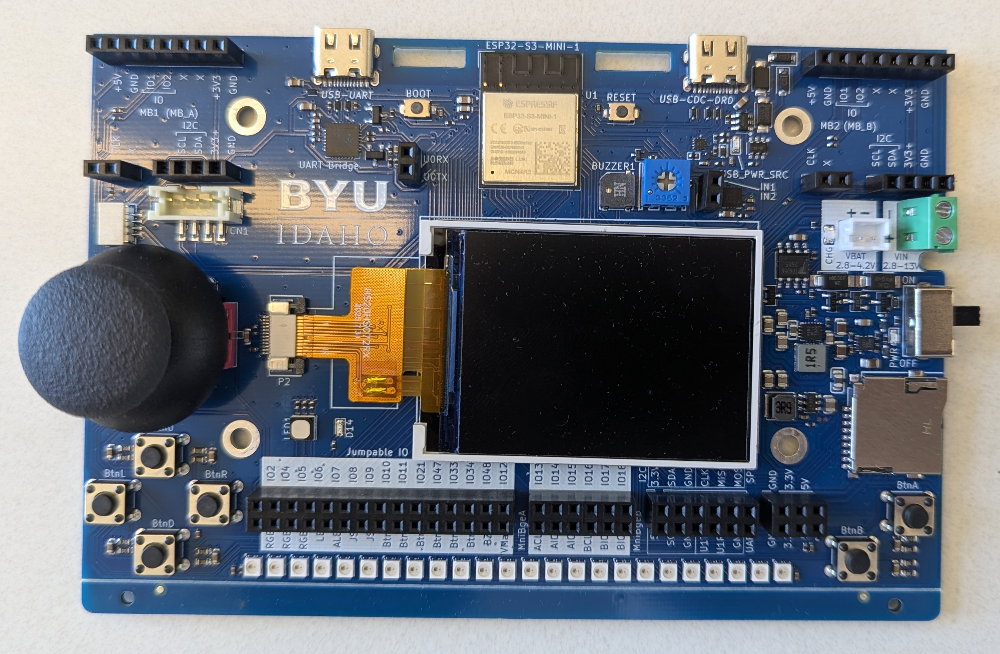
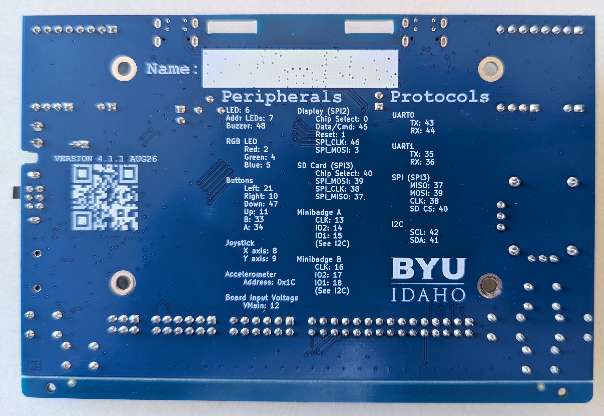

# BYU-Idaho eBadge Python Projects

This is the BYU-Idaho eBadge repository for Python projects. It includes
`byui_ebadge`, a beginner-friendly interface for the ESP32-S3 eBadge, so users
can write ordinary Python programs for its buttons, LEDs, screen, sound,
sensors, and Wi-Fi without dealing with GPIO numbers or low-level electronics
APIs.

The `byui_ebadge.py` interface supports three modes: the physical eBadge, an
interactive terminal simulator, and a headless test backend. Programs in
[`examples/`](examples/) are ready to try; put programs you write in
[`projects/`](projects/). The simulator keeps the BYU-Idaho logo as permanent
blue-board artwork, separate from the simulated screen controlled by the
running program.

## MicroPython on the eBadge

MicroPython is a version of Python designed to run on microcontrollers. Your
computer runs regular Python to use this repository's setup tools and
simulator; the eBadge runs MicroPython on its ESP32-S3. The board's MicroPython
firmware provides the Python runtime and built-in modules. This repository
provides `byui_ebadge.py` and the hardware drivers that connect those helpers
to the eBadge's buttons, display, LEDs, buzzer, sensors, and Wi-Fi. These
library files are copied to the badge with `deploy.py --install-library`;
they are not part of the firmware.

For a general introduction to writing MicroPython on an ESP32, see the
official [MicroPython tutorial for ESP32](https://docs.micropython.org/en/latest/esp32/tutorial/intro.html).
The setup instructions below cover the eBadge-specific firmware and tools.

After firmware startup, MicroPython runs its internal `_boot.py`, then the
badge's optional `/boot.py`, then `/main.py` if that file exists. `boot.py` is
for brief startup setup and should finish; `main.py` is the program that starts
when the badge powers on or resets. If `main.py` is missing or finishes,
MicroPython opens the interactive prompt (REPL). See the official
[MicroPython reset and boot sequence](https://docs.micropython.org/en/latest/reference/reset_boot.html).

By default, `deploy.py` copies your selected program to `/main.py`, replacing
any existing `/main.py`, so the new program runs automatically on the next
reset or power-on. It does not replace `boot.py`. Use `--keep-name` to copy a
program under its original filename instead; that program will not start
automatically, but can be run from the REPL as described below.

## Using and sharing this project

Use this repository as the maintained source for the library, examples, and
setup instructions. Try the maintained examples in `examples/`; put your own
programs in `projects/`. This keeps personal work separate from examples and
the shared library, especially when you fork the repository. Normal use should
not require editing library internals.
Users can fork or clone the repository when GitHub access is available. For
restricted or offline environments, distribute a ZIP or prepared checkout.
After the initial copy, programs can be developed without network access.

Record a known repository revision when reproducibility matters. Keep personal
programs and generated files separate from maintained library changes. The API
is still under implementation, so this project does not currently require a
pip package. Once the API is stable, a versioned host-side package may be an
additional simulator installation option; badge deployment will still require
copying MicroPython-compatible files to the device. See the
[user workflow recommendation](specifications/user-workflow.md) for the
distribution tradeoffs.

The API includes accelerometer and battery-voltage helpers. Battery readings
are voltages, not estimated charge percentages; the physical battery reading
uses a nominal divider ratio and still needs calibration. Normalized joystick
directions are available in the simulator and test backend, while hardware
support remains disabled until its direction and center behavior are
calibrated. BLE and SD-card support are deferred future work.

Hardware mode also provides `connect_wifi()`, `disconnect_wifi()`,
`is_wifi_connected()`, `download_url()`, and `post_url()`. HTTP helpers require
an active Wi-Fi connection and an optional `urequests` or `requests` module on
the badge. GET returns response bytes or saves them to a filename; POST returns
response bytes. Responses are closed after use. The GET helper reads the full
response into memory, so use it for files that fit the badge's available RAM.

For on-device setup, `connect_wifi_with_screen()` lists visible networks. Use
Up/Down and A to choose one, then enter the password with Up/Down to select a
character, Left/Right to change character groups, A to add, B to erase, and
Left+Right to connect. `wifi_info()` returns a dictionary with `connected`,
`ssid`, `signal_dbm`, and `ip_address`; `display_wifi_info()` shows the same
details on the screen. These helpers use MicroPython's built-in `network`
module; the optional HTTP package is only needed for GET and POST requests.
The screen setup flow lists visible networks; use `connect_wifi(ssid, ...)`
directly to join a hidden network.

The terminal simulator models buttons, joystick positions, the screen, LEDs,
and buzzer activity. It does not model Wi-Fi scanning or connections, HTTP,
accelerometer or battery readings, external GPIO, voltage measurement, or PWM
output. It is not a full electrical simulation.

## Board photographs

These V4.1.1 photos show the current target board. The front shows the controls
and components; the back includes a printed quick reference for GPIOs and buses.





## Repository structure

| Path | Purpose |
| --- | --- |
| `byui_ebadge.py` | User-facing API shared by all runtime modes. |
| `backends/` | Hardware, simulator, and headless test implementations. The maintained `backends/hardware/` package contains the on-device drivers. |
| `deploy.py` | Host-side helper that uses `mpremote` to copy the library, a program, and optional assets to the badge. |
| `assets/board/` | eBadge Git submodule and hardware design source (initialize with the submodule command below). |
| `specifications/` | Python standards and the current V4.1.1 board specification. |
| `examples/` | Ready-to-try programs demonstrating the public API. |
| `projects/` | Workspace for programs you create, especially in your own fork. |
| `simulator.py` | Runs an example or project program locally with the terminal simulator. |
| `resize_image.py` | Host utility that prepares one image or a directory tree of 24-bit BMPs for the badge display. |
| `assets/lego-python.png` | Source image used by the display example. |
| `assets/lego-python_badge.bmp` | Prepared BMP image used by the display example. |

The current board target is V4.1.1. The hardware specification documents the
board design, production netlist, and physical layout. Firmware-dependent behavior and ADC calibration are called out where
they still need validation on physical hardware.

### Board labels, GPIO numbers, and jumper bridges

The board silkscreen uses labels such as `IO13`; these identify the same signal
as ESP32 `GPIO13`. They are GPIO numbers, not physical lead numbers on the
ESP32 module. Code and pin helper functions use the ESP32 GPIO number. For
example, board label `IO13` corresponds to GPIO value `13`.

The board has removable jumper bridges that connect onboard devices and
headers to GPIO signals. The board specification and built-in peripheral
helpers describe the standard, as-built bridge positions. Removing or moving a
bridge changes the electrical routing: a built-in device may no longer be
connected to the GPIO its helper expects, and a GPIO may become available for
an external circuit. The software cannot detect a manually changed bridge.
Built-in peripheral helpers support the standard routing only. If a bridge is
changed, record the new route and use `configure_pin()` / `read_pin()` /
`write_pin()` / `set_pwm()` with the GPIO signal actually connected; restore
the standard bridge positions before using the built-in peripheral helper
again. The current API does not let users remap a built-in peripheral helper.

The V4.1.1 upstream production netlist confirms GPIO13–GPIO18 are routed to
J9's odd-numbered contacts (1, 3, 5, 7, 9, and 11). The upstream BOM's U1
description says `ESP32-S2-MINI-1`, while its manufacturer part number and the
design files identify an ESP32-S3-MINI-1-N4R2. Use the GPIO signal names in
software; do not infer module pad numbers from that inconsistent description.

The `set_pwm(pin, frequency_hz, duty_percent)` helper uses a duty
percentage from 0 to 100. A duty of `0` keeps the output off; `100` keeps it
on. For example, this requests a 1,000 Hz signal that is on half of each cycle:

```python
byui_ebadge.set_pwm(byui_ebadge.GPIO13, frequency_hz=1000, duty_percent=50)
```

The small RGB LED and the addressable LED strip have separate names. The
agreed API uses `set_rgb_led(color)` for the small indicator and
`set_led_strip_pixel(index, color)`, `set_led_strip(colors)`, and
`clear_led_strip()` for the 24-pixel strip. For an animation, a program can
update a whole frame in a loop and control the frame delay itself:

```python
byui_ebadge.set_led_strip(frame_colors)
byui_ebadge.pause(80)  # wait 80 milliseconds before the next frame
```

Frame updates and timing are separate; animations do not require a predefined
animation or a timing list.

The display API also includes `draw_pixel()`, `draw_line()`, and
`draw_rectangle()`. A rectangle can be outlined or filled with `filled=True`.
The current simulator uses a terminal interface, so its screen is limited to
text character cells rather than the badge's 320 × 240 pixels. It records
drawing operations and their coordinates as text; games and graphics therefore
do not appear as rendered objects, and may look or feel different from the
physical display. The simulator still models clickable controls, display
operations, LEDs, and buzzer output. A pixel-rendered screen would require a
graphical simulator backend or a terminal renderer with its own pixel buffer.

The upstream eBadge source is tracked as a Git submodule. Initialize it after a
fresh checkout with:

```sh
git submodule update --init --recursive
```

The V4.1.1 KiCad design is in
[`assets/board/hardware v4.1.1/badge-esp32-s3/`](<assets/board/hardware v4.1.1/badge-esp32-s3/>).

## Set up MicroPython on the eBadge

The badge uses an ESP32-S3. Connect the computer to the badge's USB-C port
labeled **USB-UART** with a data-capable cable. Install the host tools:

```sh
python -m pip install esptool mpremote
```

### Automated first-time setup

From the repository checkout, run the script for your shell:

**Windows PowerShell:**

```powershell
.\initial-setup.ps1
```

**macOS, Linux, or Git Bash:**

```bash
bash ./initial-setup.sh
```

Both scripts download the pinned MicroPython 1.29.0 ESP32-S3 firmware
(`ESP32_GENERIC_S3-20260824-v1.29.0.bin`) into `assets/` only if it is not
already there. The firmware binary is ignored by Git. The scripts erase the
badge's entire flash, install the firmware using automatic serial-port
detection, and use `deploy.py` to copy the eBadge library, the prepared logo
image, and example 04 as `/main.py`. The Bash script also needs `curl` or
`wget` if it must download the firmware.

Erasing flash removes programs and other files already stored on the badge.
After flashing, the scripts wait for MicroPython's first-boot filesystem setup
and retry deployment if the badge is not ready. When setup finishes, power
cycle the badge or press its reset button to run the logo program. The scripts
do not take a port argument; if automatic detection fails, follow the manual
steps below and specify the correct port.

### Manual firmware setup

For manual setup, first find the serial port assigned to the badge:

- **Windows:** a port such as `COM3` in Device Manager under **Ports (COM & LPT)**.
- **macOS:** usually `/dev/cu.usbmodem...` or `/dev/cu.usbserial...`.
- **Linux:** usually `/dev/ttyACM0` or `/dev/ttyUSB0`; your account may need serial-device permissions.

Download a MicroPython firmware build for a generic ESP32-S3 from the
[MicroPython ESP32-S3 downloads](https://micropython.org/download/ESP32_GENERIC_S3/).
Use the filename of the firmware image you downloaded in the command below.

Erase the badge flash and install the firmware. Both commands try to find the
Espressif device automatically:

```sh
python -m esptool erase-flash
python -m esptool --baud 460800 write-flash 0 FIRMWARE.bin
```

If automatic detection does not find the badge, specify its serial port by
adding `--port <PORT>` before `erase-flash` or `write-flash`.

If the board does not enter download mode, hold **BOOT** while starting the
flash operation, then release it once flashing begins. Check the installed
`esptool` help if its command syntax differs from these commands.

Open the MicroPython REPL (interactive prompt):

```sh
python -m mpremote repl
```

At the `>>>` prompt, try `print("Hello from the eBadge!")`. Press **Ctrl-]** to
leave the REPL. `mpremote` automatically connects to the first available USB
serial device. If it does not find the badge, connect explicitly with
`python -m mpremote connect <PORT> repl`.

## Run the headless tests

The pytest suite uses the deterministic test backend. It does not launch the
terminal simulator or require an eBadge:

```sh
python -m pip install pytest
python -m pytest
```

GitHub Actions runs this suite automatically on every push and pull request.
The tests are collected from `tests/`; project examples and setup documentation are not test modules.

The headless suite also checks deterministic accelerometer and voltage values.
It cannot validate the physical sensors or ADC calibration.

## Run the terminal simulator

Install Textual:

```sh
python -m pip install textual
```

From the repository root, use `simulator.py` with an example name, a project
name, or a Python file path:

```sh
python simulator.py 01_button_led
python simulator.py snake
python simulator.py projects/my_program.py
```

The `.py` suffix is optional for names in `examples/` and `projects/`. The
runner adds the repository and program directories to `PYTHONPATH` and runs
the program from the repository root. On a computer, `byui_ebadge.initialize()`
automatically selects the simulator. For example, to open the sample screen
and LED output:

```sh
python simulator.py 00_led_strip
```

The clickable D-pad and A/B buttons model physical buttons; the separate
joystick pad sets normalized joystick positions until centered again.
The screen, RGB indicator, 24 strip LEDs, and buzzer state are shown in the
terminal board. Press `q` to close the board and **Ctrl-C** to stop a running
example program.

## Run the examples

The programs in [`examples/`](examples/) are complete examples to run and
adapt. Put your own programs in `projects/` to keep them separate from the
maintained examples.

1. Light the RGB LED while button A is held.
2. Scan for and list nearby Wi-Fi networks.
3. Play a tone when button A is pressed.
4. Display the LEGO Python image from `assets/lego-python.png`.
5. Draw pixels, lines, and outlined and filled rectangles.
6. Cycle through prepared photos in a directory.
7. Play Snake with the directional buttons.
8. Draw with the directional buttons in Etch-a-Sketch.
9. Play Tetris with the directional buttons.
10. Choose and launch installed programs with `program_selector.py`.
11. Connect to Wi-Fi, download a file with HTTP GET, and send JSON with HTTP
    POST.
12. Select a Wi-Fi network on the badge and display its connection details.
13. Play the Popcorn melody on the piezo buzzer.

Snake and Tetris use the D-pad; the Etch-a-Sketch example uses the D-pad to
draw, A to change color, B to toggle the eraser, and A+B to clear the canvas.
Tetris uses left/right to move, up to rotate, down to speed up the drop, A to
pause, and B to start a new game.

These programs use `byui_ebadge.py`. Some physical hardware behavior still needs
validation; see [TODO.md](TODO.md) for remaining work and hardware limitations.

### Build a simple program

Create `projects/my_program.py`. Initialize the library, check a button with
`is_pressed()`, and use the display and RGB LED helpers:

```python
import byui_ebadge


def main():
    byui_ebadge.initialize()
    last_pressed = None
    try:
        byui_ebadge.display_clear()
        byui_ebadge.display_text("Hold A to light blue", x=8, y=8)
        while True:
            pressed = byui_ebadge.is_pressed(byui_ebadge.BUTTON_A)
            if pressed:
                byui_ebadge.set_rgb_led("blue")
            else:
                byui_ebadge.turn_rgb_led_off()

            if pressed != last_pressed:
                message = "Button A is down" if pressed else "Button A is up"
                byui_ebadge.display_clear()
                byui_ebadge.display_text(message, x=8, y=8)
                last_pressed = pressed

            byui_ebadge.pause(20)
    except KeyboardInterrupt:
        pass
    finally:
        byui_ebadge.shutdown()


if __name__ == "__main__":
    main()
```

Run the program in the computer simulator using the [simulator instructions](#run-the-terminal-simulator):

```sh
python simulator.py projects/my_program.py
```

To run it on the badge, connect the board and deploy the library and program:

```sh
python deploy.py --install-library projects/my_program.py
```

`is_pressed()` returns `True` while the named button is held. The display
helpers use pixel coordinates with `(0, 0)` at the top-left; `display_text()`
draws a line of text, and `display_clear()` fills the screen before drawing.
Use other names such as `BUTTON_B`, `BUTTON_UP`, and `BUTTON_LEFT` to read the
other buttons. Examples are ordinary Python programs and can be adapted
without editing `byui_ebadge.py`.
Before running the logo example, prepare the PNG for the display with the
host utility. Install Pillow if it is not already available:

```sh
python -m pip install pillow
python resize_image.py assets/lego-python.png
```

This creates `assets/lego-python_badge.bmp`, an uncompressed 24-bit BMP resized to fit
the 320 × 240 display while preserving the source aspect ratio. Small source
images are not enlarged.

To prepare a directory of photos for the board, convert the whole directory
tree into a separate sibling folder, then deploy that folder:

```sh
python resize_image.py photos/
python deploy.py --directory photos_badge/
```

The converter writes BMP files under `photos_badge/`, preserving subfolders
and using `_badge.bmp` filenames. `deploy.py --directory` copies the directory
tree to `/photos_badge/` on the badge.

For a repeating slideshow, deploy the photo folder with the picture-frame
example and copy the example as the program:

```sh
python deploy.py --install-library --directory photos_badge/ examples/06_picture_frame.py
```

The frame cycles through BMP files directly inside `photos_badge/`, showing
each for three seconds. Images in nested subfolders are deployed but are not
included in this simple slideshow.

### Deploy programs to the badge

`mpremote` is a Python package with a command-line interface. Install it with
the host tools above, then use `deploy.py` to upload programs and files. On
first deployment, include `--install-library` to copy `byui_ebadge.py` and the
backend directory:

```sh
python deploy.py --install-library examples/01_button_led.py
```

`deploy.py` and `mpremote` automatically select the first available badge.
Use `--port <PORT>` with `deploy.py` only if automatic detection does not find
the badge or you need to select a specific device.

After deploying a new or updated Python script, restart the board with its
power switch or press the reset button so MicroPython loads the updated
`/main.py`. Copying a script does not stop or restart a program that is already
running. A script deployed with `--keep-name` must still be launched from the
REPL.

The script copies the selected program to `/main.py`. After the library is
installed, later programs do not need the library flag:

```sh
python deploy.py examples/05_display_shapes.py
```

Use `--keep-name` when you want to keep the source filename on the badge
instead of replacing `/main.py`. This is useful when launching a program from
the interactive MicroPython REPL. A file kept under its own name does not run
automatically on boot; use the default `/main.py` destination for that:

```sh
python deploy.py --install-library --keep-name examples/03_button_tone.py
python -m mpremote repl
```

At the MicroPython `>>>` prompt, run the deployed file with:

```python
exec(open("/03_button_tone.py").read())
```

If you want to call its `main()` function directly, import the module and call
the function:

```python
button_tone = __import__("03_button_tone")
button_tone.main()
```

The usual `import module_name` syntax cannot be used here because the example
filename starts with a number. For files with names that start with a letter,
use `import module_name` followed by `module_name.main()`.

The same command works with `/main.py` if you used the default deployment
name. Press **Ctrl-C** to interrupt a running program; press **Ctrl-]** to
leave the REPL. Programs that define a `main()` function can also be imported
by module name and started with `module_name.main()`.

Prepare the image first, then deploy example 04, the library, and the BMP in one
command. By default, `deploy.py` saves the selected program as `/main.py`, so it
runs automatically when the badge starts:

```sh
python resize_image.py assets/lego-python.png
python deploy.py --install-library --asset assets/lego-python_badge.bmp examples/04_display_logo.py
```

Use `--asset FILE` to copy another resource to the badge's root directory;
repeat the option to copy more than one asset. The same flag can upload a
manual test runner without replacing `/main.py`:

```sh
python deploy.py --asset hardware_tests/run_byui_ebadge_checks.py
```

Use `--directory DIR` to recursively copy a complete folder to the badge,
preserving its name and nested paths. For example, this uploads local `photos/`
to `/photos/`:

```sh
python deploy.py --directory photos
```

You can combine `--directory` with `--install-library`, a program, and asset
options in one deployment command.

To clear Python source and bytecode files from the badge before installing a
fresh copy of the library and a program, use `--erase-python`:

```sh
python deploy.py --erase-python --install-library examples/01_button_led.py
```

This recursively deletes every `.py`, `.mpy`, and `.pyc` file, including
`/main.py`, `/boot.py`, and installed libraries. It keeps non-Python assets
such as BMP images and photos. When combined with deployment options, removal
happens before the requested library, program, and assets are copied. Review
the paths on the badge before using this option; deleting `/boot.py` or
`/main.py` changes startup behavior.

To use the button-controlled program selector, deploy it as the badge's
`main.py` and copy the programs you want to run as assets. Up/Down selects a
program and A launches it. Programs should return normally or handle
Ctrl-C/KeyboardInterrupt to return to the menu.

```sh
python deploy.py --install-library \
  --asset examples/01_button_led.py \
  --asset examples/05_display_shapes.py \
  program_selector.py
```

Add more `--asset` options to install more programs. The selector scans `.py`
files in the badge root and skips `main.py`, `boot.py`, `byui_ebadge.py`, and the
selector itself.

The deploy helper starts `mpremote` through the same Python interpreter used
to run the script. The package must be installed in that environment. It copies
the maintained backend and driver modules when `--install-library` is used;
these library files are installed separately from user programs.

`HardwareBackend` owns the eBadge pin setup and peripheral operations.
The `backends/hardware/` package supplies its ST7789 display driver and font.
The addressable LED strip uses MicroPython's `neopixel` module when that
feature is called.
The hardware joystick mapping uses center and endpoint ADC readings measured
on one V4.1.1 badge, with a 0.08 normalized dead zone. Other badges may need
their readings checked with `hardware_tests/run_joystick_calibration.py`.
Battery-voltage readings use the nominal ×16 divider ratio and still need
calibration on the physical board. Confirm the VMain-to-IO12 jumper is
installed; the software cannot detect that bridge. GPIO13–GPIO18 voltage
readings use MicroPython's per-chip calibrated ADC conversion and require
Wi-Fi to be inactive. Verify readings on the physical badge before relying on
them.

## Run guided checks on the physical badge

Use a physical V4.1.1 badge with MicroPython installed and deploy the hardware
library first. From the repository root, note the software revision, upload
the guided runner as an asset, and open the interactive REPL:

```sh
git rev-parse --short HEAD
python deploy.py --asset hardware_tests/run_byui_ebadge_checks.py
python -m mpremote repl
```

The runner uses keyboard prompts, so launch it from the interactive REPL, not
with `mpremote run`. At the MicroPython `>>>` prompt, enter:

```python
import run_byui_ebadge_checks
run_byui_ebadge_checks.main()
```

Follow the prompts to press and release each button, confirm LED/display/tone
output, inspect Wi-Fi results, and record each check as pass, fail, retry, or
skip. The runner prints a final summary and checks the joystick center and all
four normalized directions. To inspect raw joystick ADC values separately,
deploy `hardware_tests/run_joystick_calibration.py` and call
`run_joystick_calibration.main()` from the REPL.

Optional GPIO checks require a wire between GPIO13 and GPIO14; connect no
power source for that loopback. The PWM check needs an oscilloscope or an LED
with a current-limiting resistor. The ADC check needs a known source within the
documented measurement range and a common ground. Skip any check when its safe
test setup is unavailable. The battery reading is a nominal estimate; compare
it with a meter only when the VMain-to-IO12 jumper is fitted and Wi-Fi is
inactive.

Record the date, badge revision, MicroPython firmware version, and software
revision along with the summary. Keep failed checks and skipped checks with
their reasons; for ADC and battery checks, include the source or meter voltage
and the value reported by the badge. Use this format when recording a run:

```text
Date:
Badge revision: V4.1.1
MicroPython version:
Software revision:
PASS:
FAIL:
SKIP (with reason):
ADC source/meter voltage and badge reading:
Battery meter voltage and badge estimate:
Notes:
```

The test runner does not upload its summary elsewhere. Save the results with
the project issue or TODO entry used to track the physical validation, and
investigate failures before treating the corresponding feature as validated.

To check `HardwareBackend` directly, upload and import its runner:

```sh
python deploy.py --asset hardware_tests/run_hardware_backend_checks.py
python -m mpremote repl
```

At the MicroPython prompt, enter `import run_hardware_backend_checks` followed
by `run_hardware_backend_checks.main()`.

Both scripts print a pass/fail/skip summary. They do not change jumper bridges
or infer their positions.

### Joystick values

The `byui_ebadge.joystick()` function returns a tuple `(x, y)` in the simulator
and test backends, with each axis ranging from `-1.0` to `1.0`. For example:

```python
x, y = byui_ebadge.joystick()
```

For `x`, `-1.0` means fully left and `1.0` fully right. For `y`, `-1.0`
means fully down and `1.0` fully up. Values near zero mean the stick is near
the center. These are normalized direction values, not raw voltage or ADC
readings. The hardware backend uses the current V4.1.1 calibration and applies
a 0.08 dead zone around the center. Its calibration measurements were
GPIO8/X center 2012, left 455, right 3951; GPIO9/Y center 1977, down 342, up
4092. These are raw ADC counts from one physical badge.
To verify the normalized hardware readings without repeating the full test
suite, run `run_byui_ebadge_checks.run_joystick_check()` from the MicroPython
REPL.

The setup instructions above cover firmware installation and REPL access. Earlier MicroPython demonstrations exercised the buttons, joystick, RGB and addressable LEDs, buzzer, display, Wi-Fi, accelerometer, battery readings, and exposed GPIO. The hardware specification summarizes which capabilities are supported by the current library.

## Specifications and contribution notes

- [User repository workflow recommendation](specifications/user-workflow.md)
- [Python software specification](specifications/python.md)
- [eBadge V4.1.1 hardware specification](specifications/hardware-v4.1.1.md)
- [Project instructions](AGENTS.md)
- [Open tasks](TODO.md)

Python standards in the software specification apply to new project code. Do
not reformat upstream files in `assets/board/` to match those standards.
