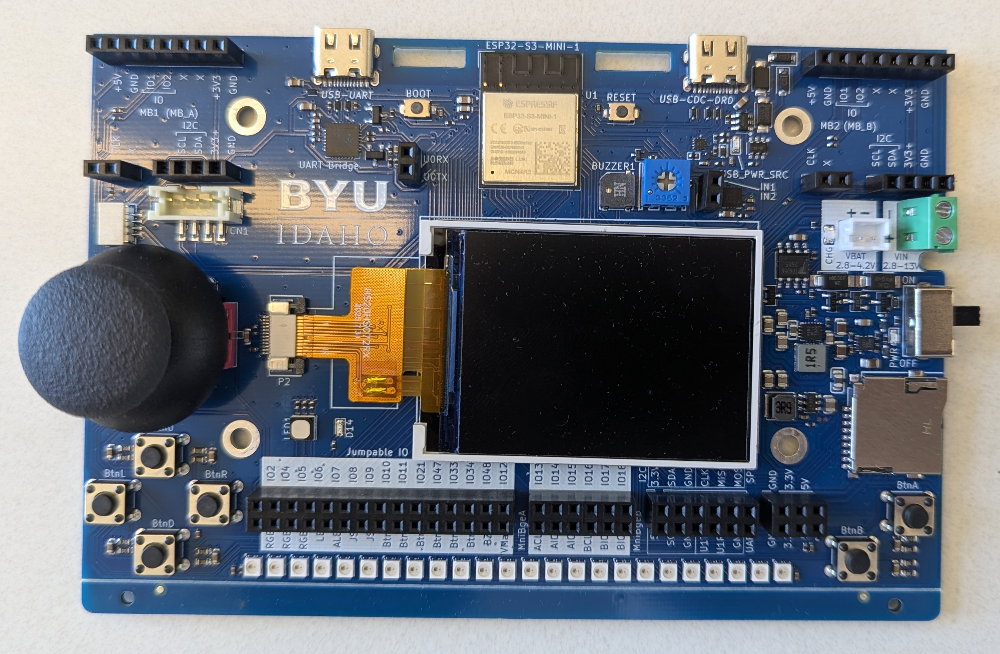
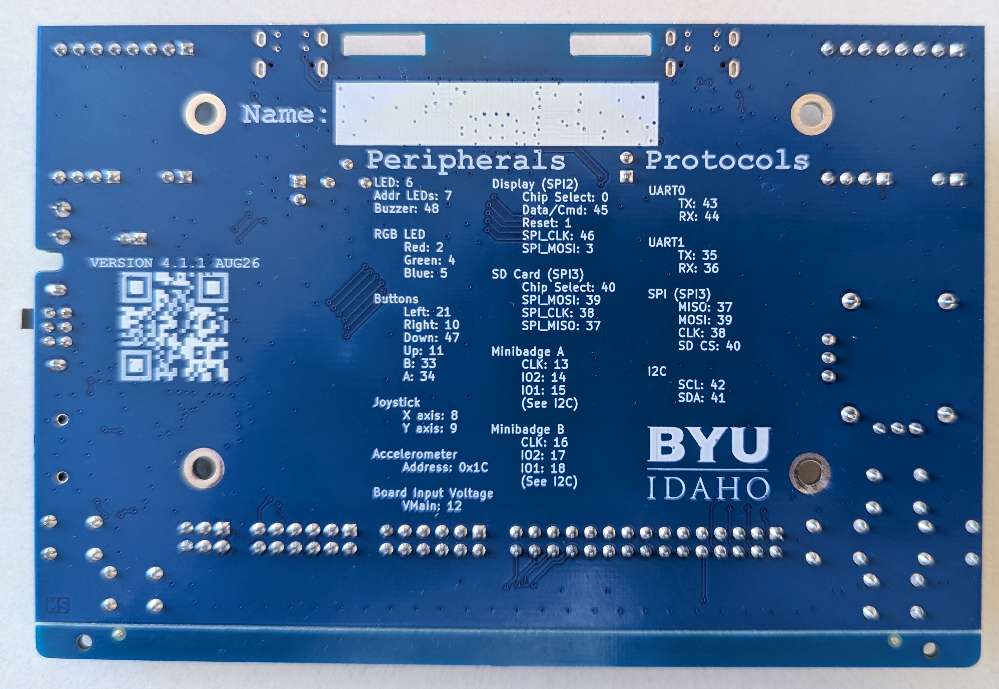

# eBadge hardware specification: V4.1.1 target

## Scope and evidence

This document is the hardware reference for the `byui_ebadge.py` interface and targets board revision V4.1.1. It combines the [board_info_v4_1.md](board_info_v4_1.md) notes with the upstream V4.1.1 CAD/BOM/netlist under `assets/board/hardware v4.1.1/badge-esp32-s3/` (the upstream directory name contains spaces). Arduino setup instructions remain in `board_info_v4_1.md`; this file focuses on board facts and implications for the beginner-facing Python API.

The V4.1.1 [front](../assets/byui-ebadge-front-4_1_1.jpg) and [back](../assets/byui-ebadge-back-4_1_1.jpg) photos show the physical board and its silkscreen pin reference. Use these for revision-specific visual details.

## Board overview

- **Controller:** ESP32-S3 module, as shown in the board photograph. The software targets ESP32-S3 MicroPython.
- **Display:** color TFT, driven by an ST7789 controller over SPI. The logical display resolution is 320 × 240 pixels.
- **Inputs:** two action buttons (A and B), four directional buttons, and an analog two-axis joystick.
- **Outputs:** one single-color LED, one RGB LED, an audible buzzer, and a ring/strip of 24 addressable LEDs.
- **Motion sensing:** an MMA8452 accelerometer uses I²C at address `0x1C`.
- **Wireless:** the ESP32-S3 supports Wi-Fi and Bluetooth Low Energy. MicroPython support depends on the installed firmware and its `network` or `bluetooth` modules.
- **Storage:** onboard microSD socket on SPI3, with its V4.1.1 pin mapping listed below. MicroPython mount support still needs validation.
- **USB:** USB-UART for programming/serial and a native USB-C dual-role port capable of USB host in the Arduino examples. The board documentation identifies host mode as Arduino-only. The supplied MicroPython 1.29.0 generic ESP32-S3 firmware documents `machine.USBDevice` for USB device mode, but does not provide a USB-host HID keyboard API; a terminal that reads a physical keyboard therefore needs different firmware or a native host driver. See the [MicroPython USBDevice documentation](https://docs.micropython.org/en/latest/library/machine.USBDevice.html) and the board setup notes in [`board_info_v4_1.md`](board_info_v4_1.md).
- **Power:** USB, 1-cell LiPo (`Vbat`), or external `Vin` feed a power mux; the jumperable `BATTERYVOLTAGE`/`VMain` signal senses the selected `PWR_RAW` rail through a resistor divider.
- **Expansion:** exposed headers provide GPIO and power connections. The public API exposes GPIO13–GPIO18 for external use with 3.3 V logic.

## GPIO pin assignments and standard jumper routes

The following table summarizes the V4.1.1 GPIO mappings. Verify the standard bridge configuration before relying on a signal mapping. The upstream [`assets/board/docs/Pinout.md`](../assets/board/docs/Pinout.md) is explicitly a V3.0 pinout and must not be used as the V4.1.1 pin map.

| Function | ESP32-S3 GPIO | Details |
| --- | ---: | --- |
| TFT SPI clock (SCLK) | 46 | SPI bus 1 |
| TFT SPI data out (MOSI) | 3 | SPI bus 1 |
| TFT SPI data in (MISO) | 12 | SPI bus 1 |
| TFT reset | 1 | Output |
| TFT chip select (CS) | 0 | Output |
| TFT data/command (DC) | 45 | Output |
| Up button | 11 | Active-high |
| Down button | 47 | Active-high |
| Left button | 21 | Active-high |
| Right button | 10 | Active-high |
| B button | 33 | Active-high |
| A button | 34 | Active-high |
| Joystick X | 8 | ADC; raw readings need calibration |
| Joystick Y | 9 | ADC; raw readings need calibration |
| RGB LED red channel | 2 | PWM |
| RGB LED green channel | 4 | PWM |
| RGB LED blue channel | 5 | PWM |
| Buzzer | 48 | PWM |
| Addressable LED data | 7 | Connected to 24 addressable LEDs |
| Battery / power sense | `BATTERYVOLTAGE` net; jumper to GPIO12 for the V4.1 software path | ADC through 150 kΩ / 10 kΩ divider from `PWR_RAW`; requires calibration |
| Accelerometer SDA | 41 | I²C bus 0, 400 kHz |
| Accelerometer SCL | 42 | I²C bus 0, 400 kHz |
| External helper GPIOs | 13–18 | Supported by `configure_pin()` for exposed headers |

The V4.1.1 production netlist confirms GPIO13 through GPIO18 are available at
J9 odd-numbered contacts 1, 3, 5, 7, 9, and 11. The board silk labels these
signals `IO13` through `IO18`. These names mean the ESP32 GPIO signals; they
are not ESP32 module package lead numbers. The V4.1.1 U1 BOM row has a
description/part-number mismatch: its value field says `ESP32-S2-MINI-1`, but
its manufacturer part number is `ESP32-S3-MINI-1-N4R2`, consistent with the
V4.1.1 board design. Use the actual GPIO signal names in software.

Espressif maps GPIO13–GPIO18 to ADC2 channels 2–7, respectively. The
hardware-mode `read_voltage()` helper uses MicroPython's `machine.ADC.read_uv()`
with 11 dB attenuation. The ESP32-S3 ADC2 pins cannot be read while Wi-Fi is
active, so the helper raises a clear error in that state. MicroPython's
documented linear range for this setting is approximately 0.15–2.45 V at the
GPIO; readings outside that range are not promised to be accurate. Keep all
external signals within the board's 0–3.3 V logic range. This assignment is
supported by the [Espressif ESP32-S3 ADC channel table](https://docs.espressif.com/projects/esp-hardware-design-guidelines/en/latest/esp32s3/schematic-checklist.html#adc-functions)
and the [MicroPython v1.29 ESP32 ADC reference](https://docs.micropython.org/en/v1.29.0/esp32/quickref.html#adc-analog-to-digital-conversion).

The board uses jumper links to route device signals to GPIO header pins. The
software helpers assume the standard links shown in the board design and
documented in the board notes. Removing or moving a link can disconnect a peripheral or
change which GPIO it uses; software cannot detect that physical change. A
custom wiring profile is not currently supported. For a nonstandard link
arrangement, use the external GPIO helpers with the signal's actual GPIO number
and do not use a built-in peripheral helper whose expected route was changed.
Restore the standard link positions before using that helper again.

**GPIO 12 and battery sense:** GPIO12 is assigned as TFT MISO in the V4 GPIO mapping, while the V4.1.1 display schematic does not require a MISO connection for normal writes. The V4.1.1 production netlist shows GPIO12 at the GPIO header separately from `BATTERYVOLTAGE`; the battery sense node is a distinct jumperable signal. `board_info_v4_1.md` describes linking `VMain` to `IO12`. Treat this as a selectable jumper route, not a permanently shared net, and do not use display reads and battery measurement simultaneously if both are routed to GPIO12.

**SD card:** The V4.1.1 netlist confirms the onboard card socket uses GPIO37 (MISO), GPIO38 (clock), GPIO39 (MOSI), and GPIO40 (chip select). These signals are board-wired; GPIO40 is not available as an external chip-select. A verified V4.1.1 MicroPython SD mount workflow is not yet established, so SD is a hardware capability but still requires firmware/API validation before adding a public `byui_ebadge.py` helper.

## Physical layout and silkscreen (V4.1.1 photos)

The photographs below show the V4.1.1 board with the USB connectors at the top
and the control buttons along the bottom. The front photo shows component
placement; the back photo prints a compact pin and bus reference directly on
the blue PCB.

On the **front**:

- The landscape TFT display is near the center, slightly right of center.
- The joystick is immediately to the left of the display.
- The four directional buttons are below and to the left of the joystick. Their
  nearby labels are `BtnU`, `BtnL`, `BtnD`, and `BtnR`.
- The A and B action buttons sit along the lower-right edge, to the right of
  the screen (`BtnA` and `BtnB`).
- The row of 24 addressable LEDs runs along the lower edge of the board.
- USB-UART and USB-CDC-DRD connectors are along the top edge, on either side of
  the ESP32-S3 module. The microSD socket, power inputs, and power switch are on
  the right side in this orientation.
- Expansion sockets/headers are visible near both upper corners and in rows
  below the display. They expose GPIO, MiniBadge, I²C, SPI, power, and ground
  signals. The back silkscreen labels the interfaces; consult the tables above
  for the standard GPIO assignments.
- BYU-Idaho branding is printed permanently on the blue PCB. It is board
  artwork, separate from content drawn on the display.

The **back** silkscreen identifies the board as `VERSION 4.1.1 AUG26` and
provides quick references for peripherals, button GPIOs, joystick axes, the
accelerometer address, display SPI2, SD SPI3, UART0/UART1, I²C, MiniBadge A/B,
and `VMain: 12`. It also carries a permanent BYU-Idaho logo. The GPIO numbers
printed on the PCB are ESP32 GPIO signal numbers; for example, the header
labels `IO13`–`IO18` refer to GPIO13–GPIO18, not module package lead numbers.

The photos confirm physical placement and visible labels. Use the V4.1.1
schematic and production netlist for electrical connectivity and jumper routing.

## Capabilities and software implications

| Capability | Evidence / behavior to support |
| --- | --- |
| Buttons | Six digital inputs: A, B, up, down, left, right. The documented input mapping reports pressed when the GPIO reads high. |
| Joystick | Two analog axes, exposed as raw `(x, y)` ADC counts. A beginner API may add direction/center interpretation only after calibration behavior is verified. |
| Display | ST7789 TFT; 320 × 240 logical pixels in the current API. Text and basic drawing are available through the driver. |
| RGB LED | Three PWM channels; support named colors and/or RGB values through a friendly helper. |
| Addressable LEDs | 24 LEDs on a serial data line. The API exposes a color palette and single-pixel/ring operations. |
| Buzzer | PWM tone output with frequency in hertz and duration in milliseconds. |
| Accelerometer | I²C sensor check for MMA8451/MMA8452 ID at `0x1C`; the public helper reports acceleration in g when the sensor is recognized. |
| Battery / power monitor | V4.1.1 has a jumperable `BATTERYVOLTAGE`/`VMain` sense net across a 150 kΩ / 10 kΩ divider from `PWR_RAW`. The voltage conversion remains an estimate because the ADC scale needs calibration; calibrate before promising accurate volts. This is selected rail voltage, not charge percentage. |
| Wi-Fi | ESP32-S3 MicroPython `network.WLAN` station interface is used for scanning and connecting. Firmware and regional radio rules may affect operation. |
| Bluetooth LE | MicroPython may provide `bluetooth.BLE` and `gap_scan`; availability and exact API support depend on the installed firmware build. |
| External GPIO | GPIO13–GPIO18 are digital GPIOs and ADC2 channels on the ESP32-S3; the V4.1.1 netlist routes them to exposed J9 contacts. Use 3.3 V logic. ADC readings require Wi-Fi to be inactive and are only specified in the ADC's documented linear range. Servo control uses GPIO13 at 50 Hz. |
| SD storage | Hardware wiring is confirmed at GPIO37–40. A V4.1.1 MicroPython SD mount workflow is not yet established, so it remains outside the current API until tested on the target firmware. |

### Additional V4.1.1 capabilities and API candidates

The board design and setup notes show several capabilities beyond the current
`byui_ebadge.py` API scope:

- **Battery/power measurement:** `BATTERYVOLTAGE` is a separate jumperable
  signal. The V4.1.1 design notes identify a 150 kΩ / 10 kΩ divider from
  `PWR_RAW`, giving an ideal scale factor of 16 from ADC-pin volts to the
  selected input rail. This measures the power mux output (USB, Vbat, or Vin),
  not necessarily battery-only voltage. The ADC conversion needs physical calibration before the reported voltage
  can be considered accurate. Hardware mode currently reports a nominal estimate using the
  ADC's `read_uv()` value and the divider's ×16 ratio. Keep it clearly marked
  uncalibrated until hardware measurements settle the ADC conversion.
- **SD card:** hardware wiring is now identified above. A future API could
  expose simple file operations or mount/unmount helpers, but only after the
  selected MicroPython firmware's SD/SPI support and safe mount behavior are
  verified. Avoid returning low-level `machine.SPI` objects to beginners.
- **BLE:** the board supports Bluetooth Low Energy, while MicroPython BLE APIs
  depend on the installed firmware. A future API could offer a beginner-friendly
  scan behind a capability check.
- **USB host:** the native USB-C port has dual-role hardware, and the added
  Arduino notes include keyboard/mouse host demos. The board documentation identifies
  USB host as Arduino-only. Do not promise it from `byui_ebadge.py` until the target
  MicroPython build and host library support it.
- **Expansion:** GPIO13–GPIO18 can support PWM, digital I/O, ADC where the MCU
  and board routing permit, and external actuators such as servos. Existing
  Arduino notes include servo and stepper examples; the latter needs an
  external driver. A future beginner API may include servo angle control, but
  should explain the separate power and ground requirements.
- **Display drawing:** the ST7789 driver supports pixel, line, rectangle,
  polygon, bitmap, and text operations. The public API includes
  pixel, line, rectangle, and image helpers without exposing the driver object;
  the terminal simulator reports drawing calls as a text log rather than
  rasterizing them.
- **Animation/audio:** the current API supports animation through loop-and-pause
  timing and buzzer tones. A `play_song()` helper could be considered if
  users need nonblocking notes or note sequences.
- **Serial communication:** the design exposes UART0 through the USB-UART
  bridge and UART1 on GPIO35/36. A small serial helper may be useful for
  accessory projects, but it is lower priority than core board features.
- **Accelerometer events:** the MMA8452Q interrupt outputs are available at an
  unlabelled two-pin header near the sensor. A future interrupt/event helper
  could support tap, shake, or free-fall detection after a user connects an
  interrupt line to a free GPIO; ordinary accelerometer reads need no such
  jumper.

## Source files to verify during board setup

- `assets/board/hardware v4.1.1/badge-esp32-s3/`: authoritative target-revision layout and schematics in the upstream e-badge repository. The upstream directory name contains spaces.
- `assets/board/hardware v4.1.1/badge-esp32-s3/production/bom.csv`: revision-specific component list. It confirms 24 SK6805 addressable LEDs and an MMA8452 accelerometer.
- `assets/board/hardware v4.1.1/badge-esp32-s3/production/netlist.ipc`: physical V4.1.1 net assignments, including the SD socket, GPIO header, accelerometer, and battery-sense nets.
- [`board_info_v4_1.md`](board_info_v4_1.md): broader Arduino IDE guide and V4.1 feature notes; use this hardware spec for the consolidated `byui_ebadge.py`-oriented reference.
- `assets/board/docs/feature-requirements.md`: general eBadge feature list. It is not revision-specific.
- `assets/board/docs/Pinout.md`: labels itself V3.0; do not use it as the V4.1.1 pin map.
